# Olist Medallion Lakehouse POC — from Postgres to an AI voice call

An end-to-end data platform built in 7 days on a minimal budget:
**AWS RDS PostgreSQL → Databricks (bronze / silver / gold, Delta Lake) → ML late-delivery risk → reverse ETL to an AI voice agent (Bolna) that calls sellers**,
with data-quality checks, monitoring (CloudWatch + email alerts) and CI/CD (GitHub Actions + OIDC).

> Dataset: [Olist Brazilian E-Commerce](https://www.kaggle.com/datasets/olistbr/brazilian-ecommerce) (CC BY-NC-SA 4.0). Non-commercial POC.

---

## 1. Architecture

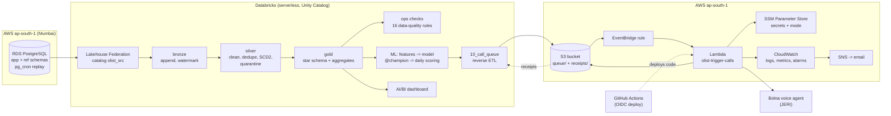

**Two clocks:** the business data is from 2017–2018 (Olist), while the pipeline runs in 2026 system time.
A `pg_cron` job in RDS replays historical orders step by step, so the lakehouse sees a "live" shop.

---

## 2. Layers and tables

| Layer | Load pattern | Key tables |
|---|---|---|
| **Source (RDS)** | `app.*` transactional tables with `updated_at` trigger; `ref.*` lookups; `etl.replay_state` | orders, order_items, order_payments, order_reviews, customers, sellers, products |
| **Bronze** | Incremental **append** using an `updated_at` watermark with a 5-minute overlap; lookups as snapshot overwrite | `olist.bronze.*`, `olist.ops.watermarks`, `olist.ops.run_log` |
| **Silver** | Full rebuild each run: latest version per key, validation against lookups, bad rows to **quarantine** with a reason; **SCD Type 2** history for sellers, products, customers | `olist.silver.*`, `*_quarantine` |
| **Gold** | Full rebuild: star schema at order-item grain, surrogate keys (`xxhash64`), `-1` Unknown members, **point-in-time SCD2 joins** | `fact_sales`, `dim_customer`, `dim_seller`, `dim_product`, `dim_date`, `agg_*`, `ops.pipeline_freshness` |
| **ML** | Daily | `gold.ml_order_features`, `gold.pred_late_delivery`, model `gold.late_delivery_model@champion` |
| **Ops** | Append | `ops.check_results`, `ops.reverse_etl_log` |

---

## 3. Jobs and schedules (Asia/Kolkata)

| Job | Schedule | Tasks |
|---|---|---|
| `olist-pipeline` | Hourly 10:05–19:05 | ingest_bronze → silver → gold → checks (critical failure fails the job) |
| `olist-ml-daily` | Daily 10:40 | ml_features → score_late_risk → call_queue |
| `olist-maintenance` | Daily 19:40 | OPTIMIZE + VACUUM (7-day retention) |
| Dashboard refresh | :25 every hour | — |

All jobs: max 1 concurrent run, timeouts, retries (except `call_queue`: 0 retries by design), failure email.
Job definitions: [`jobs/`](jobs/).

---

## 4. Machine learning: late-delivery risk

**Question:** when an order is placed, how likely is it to arrive after the promised date?

- **Features** (known at purchase time only): promised days, distance seller→customer (haversine), freight, weight/volume, states/regions, category, purchase timing.
- **Model:** scikit-learn `HistGradientBoostingClassifier` (class-weighted), **time-based 80/20 split**, logged to MLflow and registered in Unity Catalog with alias `@champion`.
- **Scoring:** daily at 10:40 for all open orders; risk bands High ≥ 0.7, Medium ≥ 0.4.

| Metric (test = newest 20% of orders) | Value |
|---|---|
| ROC AUC | **0.694** |
| PR AUC | 0.141 (baseline 0.055) |
| Top-10% riskiest: share late | 15.0% vs 5.5% overall → **lift ×2.7** |
| Top-10% riskiest: share of all late orders reached | **27.3%** |
| Top features | promised days, distance, freight, customer state/region |

> Calling only the riskiest 10% of orders reaches 27% of all late deliveries — 2.7× more efficient than random checks.

---

## 5. Reverse ETL: from a risk score to a phone call

1. `10_call_queue` picks **yesterday's High/Medium-risk open orders** (max 5/day, not sent before), maps them to the agent's variables, logs them as `sent` in `ops.reverse_etl_log`, and writes a CSV to S3 through a Unity Catalog **Volume**.
2. **S3 → EventBridge rule** (prefix `queue/delivery_risk/`) invokes the **Lambda** `olist-trigger-calls`.
3. The Lambda reads its **mode** and secrets from **SSM Parameter Store**, validates the CSV, and:
   - `dry_run` (daily default): uploads a **Bolna batch** with numbers swapped to the owner's test number and **never schedules it** → no calls.
   - `test_call`: places **one real call** to the owner's own number.
4. It writes a **receipt** to S3; the next `call_queue` run reads it and updates the log (`batch_created`, `test_called`, `failed`).

**Safety by design:** fake numbers in the data, the Lambda refuses any CSV with a real number, a duplicate guard on receipts, 0 retries, secrets only in SSM SecureString, and the agent always says it is an automated call.

---

## 6. Monitoring

- **Databricks:** 16 data-quality checks per run (`ops.check_results`), freshness table, job failure emails.
- **CloudWatch:** structured JSON logs (7-day retention), custom metrics via Embedded Metric Format (`Olist/ReverseETL`), dashboard `olist-poc`.
- **Alarms → SNS email:** Lambda errors, Bolna API errors, CSV validation errors, RDS low storage, RDS high CPU — tested end to end.

---

## 7. CI/CD

GitHub Actions ([`.github/workflows/deploy_lambda.yml`](.github/workflows/deploy_lambda.yml)) deploys the Lambda on every push that changes `reverse_etl/lambda/`.
It logs in to AWS with **OIDC** — no stored AWS keys — through a role that trusts only `main` of this repository and may only update this one function.

> Lesson learned: GitHub's OIDC `sub` claim now includes immutable owner and repository IDs
> (`repo:<owner>@<id>/<repo>@<id>:ref:refs/heads/main`). A trust policy using only names is rejected.

---

## 8. Design decisions

| Decision | Why |
|---|---|
| Lakehouse Federation instead of Spark JDBC | No credentials in notebooks, governed by Unity Catalog, simple SQL access to RDS |
| Watermark + 5-minute overlap in bronze | Never misses late-committed rows; duplicates are removed in silver |
| Full rebuild of silver and gold | Simple, idempotent and correct at this data size; easy to reason about |
| SCD2 in silver, point-in-time joins in gold | Sales are attributed to the seller/product version valid at the time |
| Time-based ML split | Mirrors real use (train on the past, predict the future); revealed real drift |
| Daily scoring at 10:40 instead of hourly | Matches a morning ops routine; ~10× cheaper |
| S3 + EventBridge + Lambda instead of a Lambda in a VPC | Lambda needs internet (Bolna), not RDS; avoids a NAT Gateway (~$1.3/day) |
| EventBridge instead of a direct S3 notification | The bucket already had a Databricks file-events notification; EventBridge avoids overlap conflicts |
| Dry run + number swap + test-call mode | Proves the integration without ever calling a real person |
| OIDC for GitHub → AWS | No long-lived keys; access limited to one repo, one branch, one function |

---

## 9. Results

| Item | Result |
|---|---|
| Orders processed (as of Oct 14, replay ongoing) | 83,900 orders, 80,120 delivered (training rows), 8.4% late |
| Data-quality checks | 16 / 16 PASS |
| Reverse ETL | dry-run Bolna batch created; one real test call completed |
| Alarms | test alarm delivered by email |
| Cost | TODO: AWS month-to-date $__ ; Databricks trial credits used __ ; Bolna credit used $__ |

---

## 10. Repository structure

```
TODO: adjust to your folders
day3/ ... day6/          bronze, silver, gold, checks, maintenance notebooks and SQL
ml/                      06 features, 07 training, 08 scoring
reverse_etl/
  notebooks/             10_call_queue.py
  sql/                   11_reverse_etl_setup.sql
  lambda/                trigger_calls.py
  aws/                   IAM, CloudWatch and OIDC templates (placeholders, no account IDs)
  bolna/                 agent setup, call script, FAQ, knowledge base
jobs/                    Databricks job definitions
dashboards/              AI/BI dashboard (.lvdash.json)
docs/screenshots/        screenshots used below
.github/workflows/       Lambda deploy
```

---

## 11. Screenshots

| | |
|---|---|
| Catalog layers | 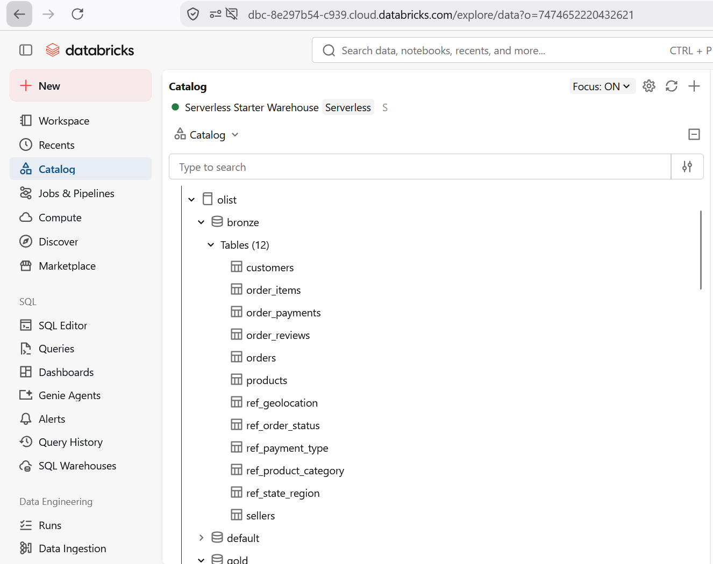 |
| Pipeline job | 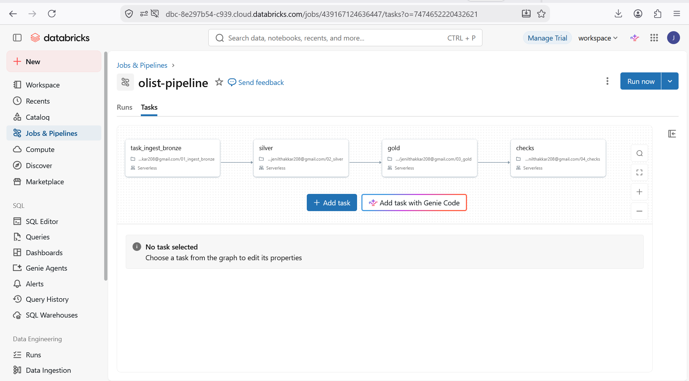 |
| Pipeline runs | 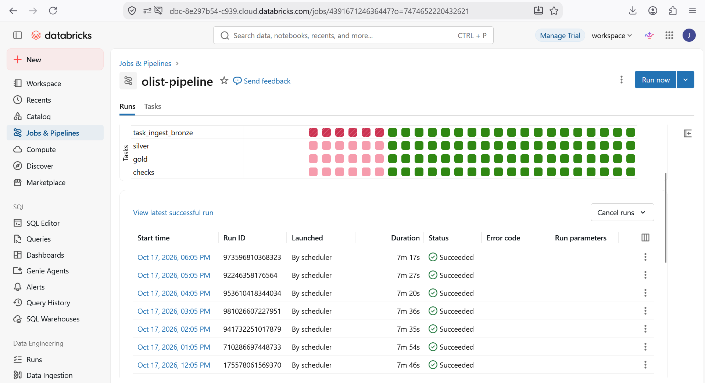 |
| Daily ML job | 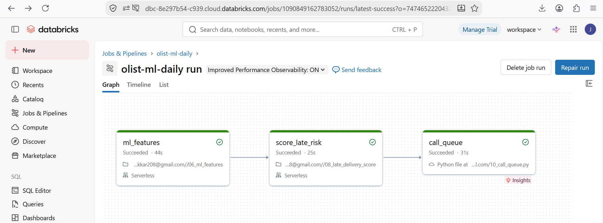 |
| Data-quality checks | 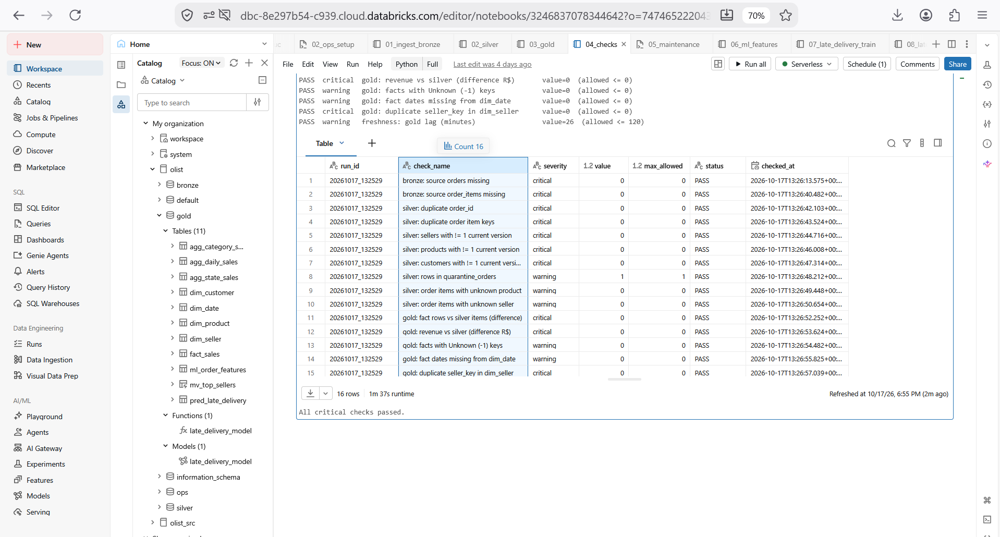 |
| Dashboard | 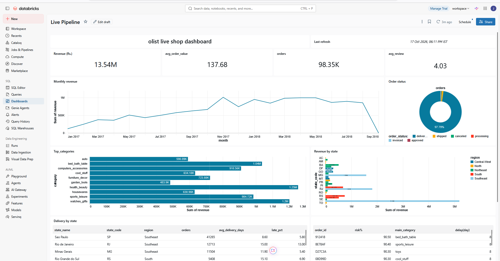 |
| Risk table | 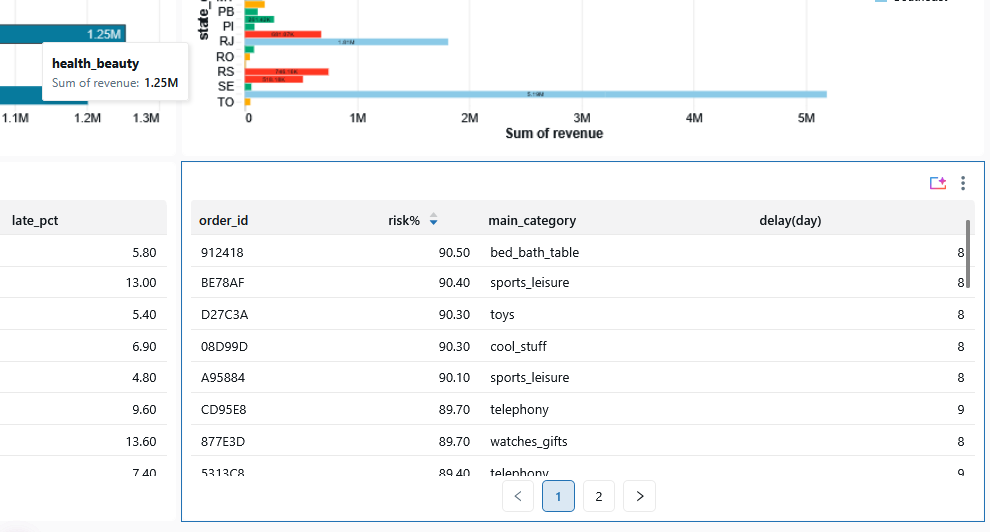 |
| ML model (@champion) | 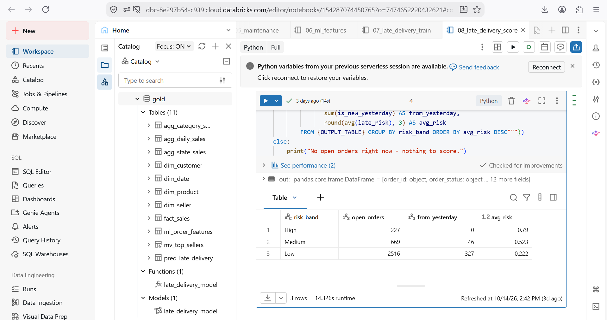 |
| Reverse ETL log | 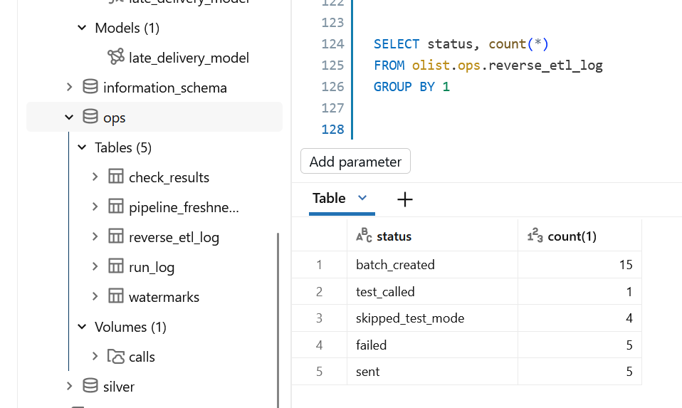 |
| S3 queue / receipts | 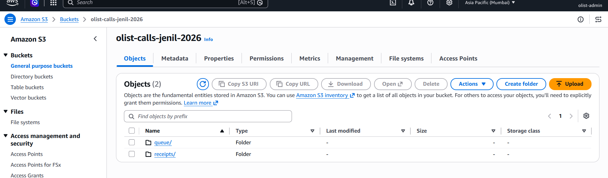 |
| EventBridge → Lambda | 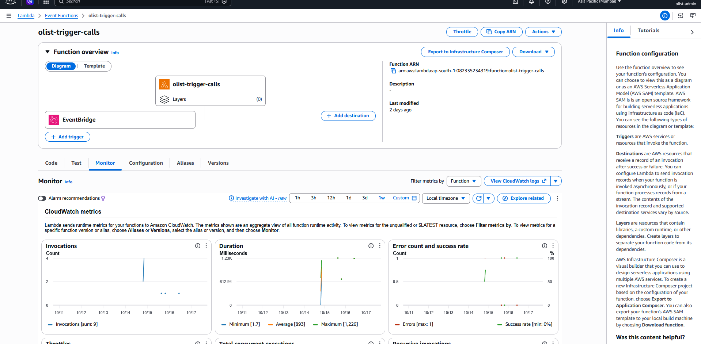 |
| CloudWatch dashboard | 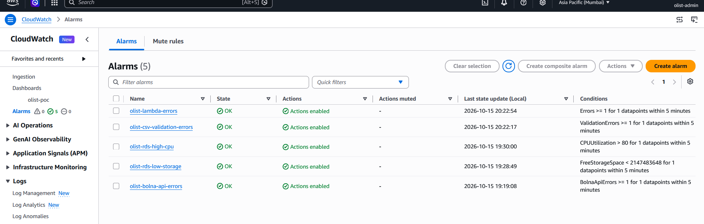 |
| Alarm email | 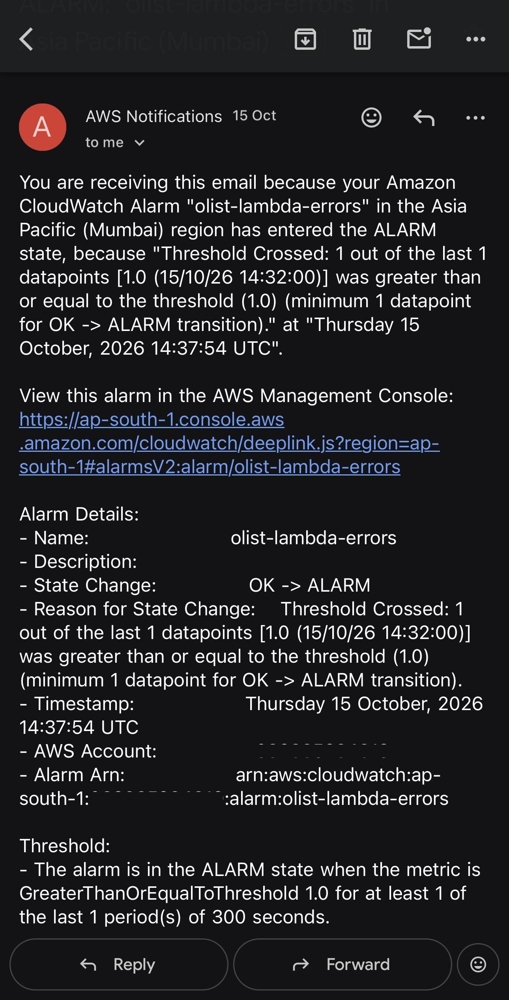 |
| RDS source | 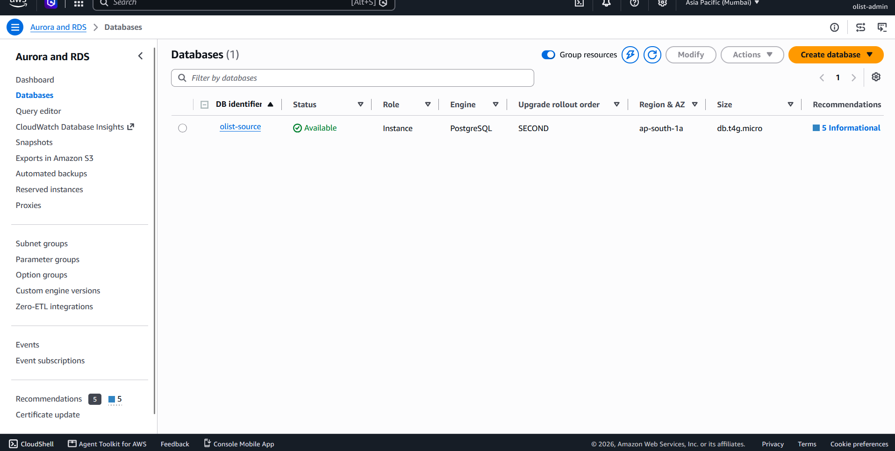 |
| Bolna agent | 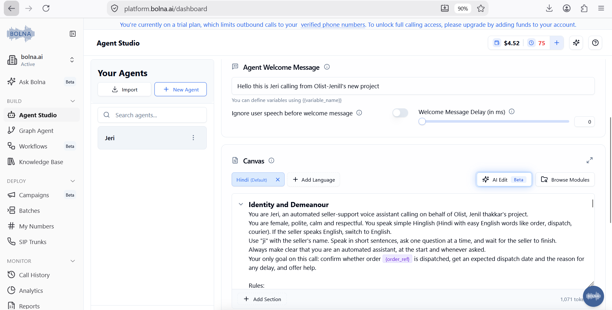 |
| Bolna batch (dry run) | 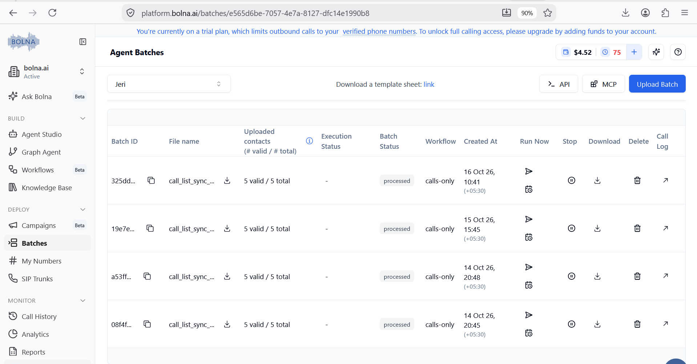 |
| Test call transcript | 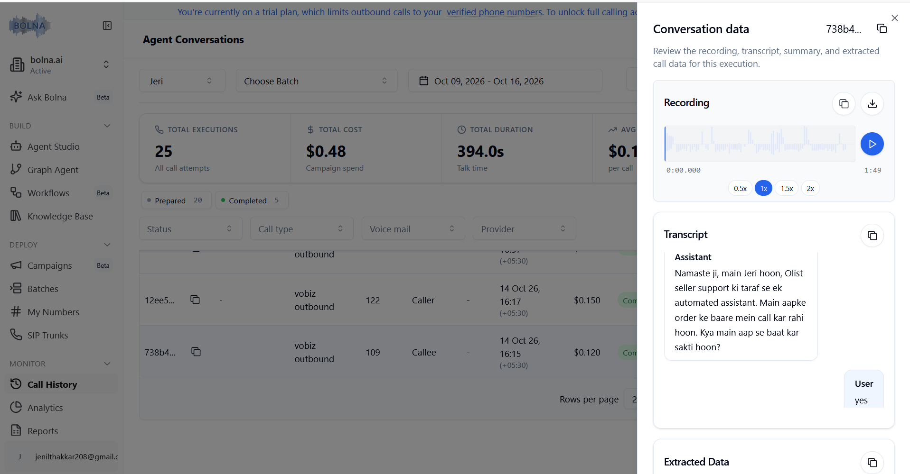 |
| GitHub Actions deploy | 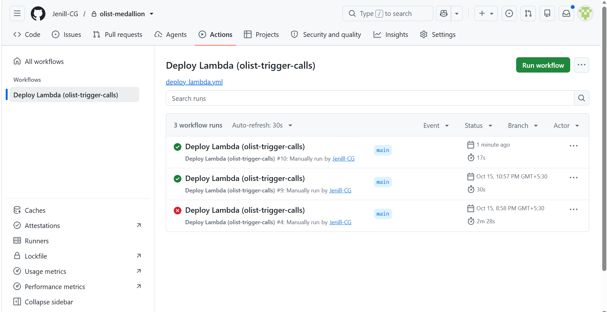 |

---

## 12. How to run (summary)

1. **RDS:** create PostgreSQL, run the seed and replay SQL, enable `pg_cron`; allow access only from Databricks.
2. **Databricks:** create the Federation connection + foreign catalog, the `olist` secret scope, then import notebooks and create jobs from [`jobs/`](jobs/).
3. **Reverse ETL:** create the S3 bucket, external location + Volume (`11_reverse_etl_setup.sql`), SSM parameters, the Lambda role (template in `reverse_etl/aws/`), the Lambda, and the EventBridge rule.
4. **Bolna:** create the agent from `reverse_etl/bolna/`.
5. **Monitoring / CI/CD:** CloudWatch dashboard template, alarms + SNS, GitHub OIDC role and repository variable `AWS_DEPLOY_ROLE_ARN`.

Secrets are never stored in this repository.
